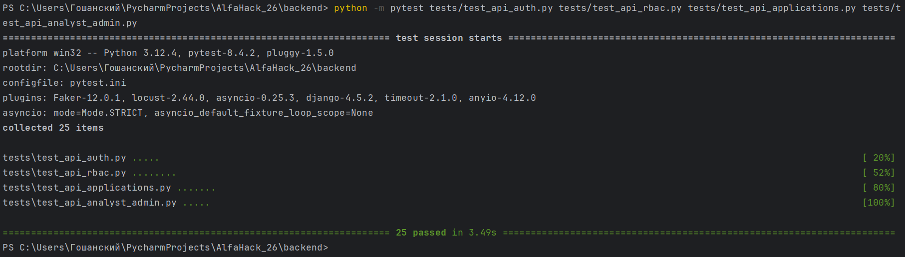

# Backend

## Оглавление

1. [Описание и стек](#1-описание-и-стек)
2. [Что умеет бэкенд](#2-что-умеет-бэкенд)
3. [Быстрый старт](#3-быстрый-старт)
4. [Конфигурация](#4-конфигурация)
5. [Архитектура и структура проекта](#5-архитектура-и-структура-проекта)
6. [API-документация](#6-api-документация)
7. [Тестирование](#7-тестирование)
8. [Демо-доступ для проверки](#8-демо-доступ-для-проверки)

---

## 1. Описание и стек

Этот бэкенд - серверная часть кредитного кабинета для малого бизнеса. Он принимает заявки от предпринимателя, гоняет их через проверки и скоринг, отдаёт очередь аналитику банка и позволяет выдать решение (одобрение, отказ или альтернативное предложение).

|              |                                                                |
|--------------|----------------------------------------------------------------|
| Язык         | Python 3.12                                                    |
| API          | FastAPI 0.115, Uvicorn                                         |
| БД           | PostgreSQL 16 (SQLAlchemy 2, Alembic)                          |
| Кэш / лимиты | Redis 7                                                        |
| Очереди      | Celery 5 (в проекте подключён, основной демо-поток синхронный) |
| Auth         | JWT (PyJWT) + Argon2                                           |
| Валидация    | Pydantic 2                                                     |
| Скоринг      | пакет `credit_scoring` из каталога `scoring/` рядом с бэкендом |
| Тесты        | pytest                                                         |

---

## 2. Что умеет бэкенд

Простыми словами - три кабинета на одном API:

**Предприниматель**  
Входит в систему, видит свою компанию и финансы, выбирает цель кредита, смотрит подходящие продукты, собирает черновик заявки, отправляет её в банк, подгружает документы, читает решение и может принять или отклонить предложение.

**Аналитик банка**  
Смотрит очередь заявок, берёт заявку в работу, запрашивает недостающие документы, пишет комментарии и выносит решение: одобрить, отказать, предложить другие условия или запросить уточнения.

**Администратор**  
Заводит пользователей, настраивает кредитные продукты и правила, смотрит аудит и может сбросить демо-данные к исходному состоянию.

Дополнительно есть загрузка банковских выписок, простой прогноз денежного потока, уведомления и текстовые разъяснения по заявке (без обязательной нейросети - работают заготовленные ответы).

Важно для понимания демо: решения и офферы здесь учебные. Это не юридическая оферта банка.

Роли в системе: `ENTREPRENEUR`, `ANALYST`, `ADMIN`.  
У предпринимателей данные разделены по компаниям - чужую компанию API не отдаёт.  
Регистрации «с улицы» и SMS-кодов нет: для демо используются заранее созданные аккаунты (см. [8](#8-демо-доступ-для-проверки)).

---

## 3. Быстрый старт

### Что нужно заранее

- Docker Desktop (или Docker Engine + Compose) - самый простой путь
- либо без Docker: Python **3.12**, доступ к PostgreSQL и Redis

Репозиторий уже должен быть у вас на машине (клон / архив хакатона).

### Вариант A - Docker (рекомендуется)

Из **корня** репозитория (не из папки `backend`):

```bash
docker compose up --build
```

Compose поднимает Postgres, Redis, накатывает миграции, заливает демо-данные и стартует API. Рядом поднимается фронт.

| Сервис   | Адрес                      |
|----------|----------------------------|
| API      | http://localhost:8000      |
| Swagger  | http://localhost:8000/docs |
| Фронт    | http://localhost:8080      |
| Postgres | `localhost:5433`           |
| Redis    | `localhost:6379`           |

Остановка: `docker compose down`.

### Вариант B - руками (API на хосте)

1. Поднять только инфраструктуру:

```bash
docker compose up -d db redis
```

2. Перейти в бэкенд и поставить зависимости:

```bash
cd backend
python -m venv .venv

# Windows
.venv\Scripts\activate

# macOS / Linux
# source .venv/bin/activate

pip install -r requirements.lock
pip install -e ../scoring
```

`requirements.lock` - полный зафиксированный набор пакетов.  
`../scoring` - ядро скоринга; без него API не импортируется.

3. Конфиг:

```bash
cp .env.example .env
```

При необходимости поправьте `DATABASE_URL` / `REDIS_URL` / `JWT_SECRET_KEY` в `.env`.

4. База и демо-данные:

```bash
alembic upgrade head
python -m scripts.seed
```

Полный сброс демо: `python -m scripts.seed --force`.

5. Сервер в режиме разработки:

```bash
uvicorn app.main:app --reload --port 8000
```

Проверка: http://localhost:8000/health -> должно вернуть статус ok.

---

## 4. Конфигурация

В корне `backend` лежит шаблон **`.env.example`**. Скопируйте его в **`.env`** и подставьте свои значения. Файл `.env` в git не коммитится - туда не кладём боевые секреты.

Основные переменные:

| Переменная                                             | Назначение                                                   |
|--------------------------------------------------------|--------------------------------------------------------------|
| `APP_ENV`                                              | Окружение (`development` / `docker` / ...)                   |
| `DEBUG`                                                | Подробные ошибки в ответе                                    |
| `DEMO_MODE`                                            | Демо-режим (сценарии, упрощения)                             |
| `DATABASE_URL`                                         | Строка подключения к Postgres                                |
| `REDIS_URL`                                            | Redis                                                        |
| `JWT_SECRET_KEY`                                       | Секрет подписи JWT (**обязательно сменить** вне демо)        |
| `FRONTEND_URL` / `BACKEND_URL`                         | URL фронта и API (CORS, ссылки)                              |
| `CORS_ORIGINS`                                         | Список разрешённых origin (через запятую), если задаёте явно |
| `ML_SERVICE_ENABLED`                                   | Внешний ML-сервис (по умолчанию выключен)                    |
| `LLM_ENABLED`                                          | Локальная LLM для агента (по умолчанию `false` - шаблоны)    |
| `LLM_BASE_URL`, `LLM_MAIN`, `LLM_LIGHT`, `LLM_API_KEY` | Настройки LLM, если включаете                                |
| `RATE_LIMIT_PER_MINUTE`                                | Лимит запросов с IP (если задан в окружении)                 |
| `UPLOAD_DIR` / лимит размера                           | Каталог загрузок (есть дефолты в коде)                       |

В `.env.example` указаны **локальные** значения для Docker-Compose (логин БД `alfa` и т.п.). Это не прод-секреты; для своей среды задайте свои.

---

## 5. Архитектура и структура проекта

Запрос идёт так: **ручка** (`api/v1`) -> проверка прав -> **сервис** (бизнес-логика) -> **модель** (Postgres) -> ответ через **schema** (JSON в camelCase).

```
backend/
├── app/
│   ├── main.py           # приложение FastAPI, /health
│   ├── config.py         # чтение .env
│   ├── deps.py           # сессия БД, текущий пользователь
│   ├── middleware.py     # логи, rate limit, request id
│   ├── api/v1/           # HTTP-эндпоинты
│   │   ├── auth.py
│   │   ├── companies.py
│   │   ├── credit.py
│   │   ├── applications.py
│   │   ├── finance.py
│   │   ├── analyst.py
│   │   ├── admin.py
│   │   ├── notifications.py
│   │   └── credit_agent.py
│   ├── schemas/          # формы запроса/ответа (Pydantic)
│   ├── models/           # таблицы БД (SQLAlchemy)
│   ├── services/         # логика: заявки, скоринг, решения, админка...
│   ├── core/             # роли, деньги, ошибки, JWT
│   └── db/               # подключение к Postgres
├── alembic/              # миграции схемы
├── scripts/seed.py       # демо-данные
├── tests/                # pytest
├── api.md                # описание всех ручек
├── requirements.txt
├── requirements.lock
└── .env.example
```

Куда что писать:

- новый URL - `app/api/v1/`
- правила «можно / нельзя» и расчёты - `app/services/`
- поле в JSON - `app/schemas/`
- новая таблица - `app/models/` + миграция Alembic

### Группа таблиц в БД

| Группа           | Таблицы                                                                                                                                                                   | Суть                                                                                                                                                   |
|------------------|---------------------------------------------------------------------------------------------------------------------------------------------------------------------------|--------------------------------------------------------------------------------------------------------------------------------------------------------|
| Auth / RBAC      | `users`, `auth_sessions`, `role_permissions`                                                                                                                              | Логин, JWT-сессии (`jti`, revoke, expiry), матрица роль->permission                                                                                    |
| Компании         | `companies`, `company_memberships`, `registry_snapshots`                                                                                                                  | ИНН/ОГРН/отрасль; кто OWNER/член; снимок «реестра»                                                                                                     |
| Финансы          | `financial_snapshots`, `financial_statements`, `transactions`, `financial_obligations`, `cashflow_forecasts`, `credit_scenarios`                                          | Агрегаты, выписки, операции (опц. к statement), обязательства, прогноз, what-if                                                                        |
| AI-чат (финансы) | `ai_conversations`, `ai_messages`                                                                                                                                         | Диалог credit-agent в контексте компании                                                                                                               |
| Потребности      | `funding_needs`, `funding_need_items`                                                                                                                                     | Цель/сумма кредита и разбивка по статьям                                                                                                               |
| Продукты         | `credit_products`, `credit_product_versions`, `credit_product_rules`, `credit_recommendations`                                                                            | Каталог, версии правил, рекомендации клиенту                                                                                                           |
| Политики банка   | `credit_policies`, `credit_policy_versions`, `policy_simulations`                                                                                                         | Опубликованные правила + симуляции на админке                                                                                                          |
| ML-реестр        | `ml_model_registry`, `model_evaluations`, `model_activations`                                                                                                             | Версии моделей, оценка, что сейчас active                                                                                                              |
| Заявки           | `credit_applications` + `application_documents`, `document_requests`, `application_status_history`, `application_comments`, `application_workflows`, `application_checks` | Черновик -> submit -> review; файлы, запросы доков, история статусов, внутренние комментарии, пайплайн проверок и их результаты (score / reason_codes) |
| Решение / оффер  | `credit_decisions`, `credit_offers`, `offer_acceptances`                                                                                                                  | Вердикт, условия (сумма/ставка/срок), факт принятия                                                                                                    |
| Договор          | `agreements`, `agreement_confirmations`                                                                                                                                   | Каркас договора после оффера + подтверждение                                                                                                           |
| Сервисное        | `notifications`, `audit_events`, `outbox_events`, `demo_scenarios`, `demo_jobs`                                                                                           | Inbox, аудит действий, outbox, сценарии демо-сида                                                                                                      |

#### Ключевые сущности (поля, на которые смотреть)

- **`users`** - `login` / `email` / `phone`, `password_hash`, `role`, `status`
- **`companies`** - `inn` (unique), `ogrn`, `legal_form`, `industry`, `region`, `employees_count`
- **`credit_applications`** - `company_id`, `product_id`, `funding_need_id`, `amount`, `term_months`, `status`, `form_data`, `idempotency_key`, `assigned_analyst_id`
- **`credit_offers`** - связь с application (+ optional decision/product), параметры предложения
- **`credit_policies` / versions** - `code`, `rules` (JSONB), версионирование без ломания уже принятых решений

---

## 6. API-документация

|                                 |                                    |
|---------------------------------|------------------------------------|
| Текстовый справочник всех ручек | [api.md](api.md)                   |
| Swagger (после запуска)         | http://localhost:8000/docs         |
| ReDoc                           | http://localhost:8000/redoc        |
| OpenAPI JSON                    | http://localhost:8000/openapi.json |

Кратко про контракт (детали - в api.md):

- префикс `/api/v1`
- JSON в **camelCase**
- деньги строками: `"1500000.00"`
- авторизация: заголовок `Authorization: Bearer <accessToken>`
- на создании/отправке заявки и принятии оффера полезен заголовок `Idempotency-Key`

---

## 7. Тестирование

Нужна живая БД с seed (как после `docker compose up` или ручного seed) и установленный пакет скоринга.

```bash
cd backend
python -m pytest tests/test_api_auth.py tests/test_api_rbac.py \
  tests/test_api_applications.py tests/test_api_analyst_admin.py -q
```

Эти тесты бьют в реальный API: логин, права ролей, изоляция компаний, отправка заявки, контрпредложение и accept оффера, доступ в админку.

Отдельного линтера (ruff / flake8 / black) в этом каталоге пока нет - ориентир по стилю: существующий код в `app/`.

Все 25 тестов пройдены.


---

## 8. Демо-доступ для проверки

Данные создаёт `scripts/seed.py` (или контейнер API при первом старте).  
Пароль у всех демо-пользователей один и тот же (только для стенда хакатона):

**`demo1234`**

| Логин               | Роль            | Зачем смотреть                                                               |
|---------------------|-----------------|------------------------------------------------------------------------------|
| `ip@demo.alfa`      | предприниматель | Компания `company_001`: черновик, одобрение, альтернатива, запрос документов |
| `ooo@demo.alfa`     | предприниматель | Компания `company_002`: отказ; проверка, что чужие заявки не видны           |
| `analyst@demo.alfa` | аналитик        | Очередь и решения                                                            |
| `admin@demo.alfa`   | админ           | Пользователи / продукты / демо                                               |

Пример логина:

```bash
curl -s -X POST "http://localhost:8000/api/v1/auth/login" \
  -H "Content-Type: application/json" \
  -d "{\"login\":\"ip@demo.alfa\",\"password\":\"demo1234\"}"
```

Дальше берите `accessToken` из ответа и ходите в API или откройте фронт на http://localhost:8080.
